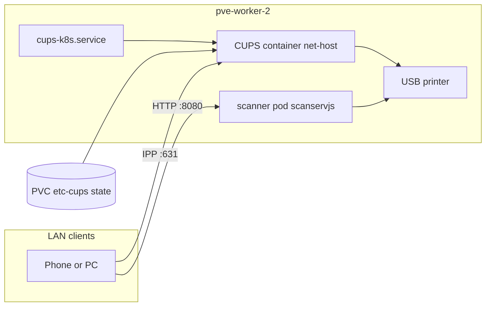

# cups-k8s

CUPS + HPLIP для USB-принтера **HP Deskjet 3050 J610 series** (`03f0:9311`) на узле `pve-worker-2`.

Репозиторий: [github.com/vutratenko/cups-k8s](https://github.com/vutratenko/cups-k8s)

## Архитектура



На кластере **Shturval/Cilium** `cupsd` внутри обычного Kubernetes pod падает с `cupsdDoSelect() failed - Bad address!`, тогда как тот же образ через `ctr run --net-host` на узле работает стабильно. Поэтому **рабочий путь сейчас — systemd unit на `pve-worker-2`**, а манифесты K8s/Argo CD оставлены для GitOps и будущего перехода, когда CRI-окружение будет совместимо.

## Печать из LAN

- **Веб-интерфейс:** [http://pve-worker-2:631/](http://pve-worker-2:631/) и [http://192.168.88.65:631/](http://192.168.88.65:631/) — админка: `/admin` (доступ с локальной сети, `@LOCAL`)
- **IPP:** `ipp://pve-worker-2/printers/HP_DeskJet_3050_J610` или `ipp://192.168.88.65:631/printers/HP_DeskJet_3050_J610`

### Обнаружение в сети

| Клиент | Что искать |
|--------|------------|
| **macOS / iOS** | Bonjour / AirPrint: **HP Deskjet 3050 J610 series @ pve-worker-2** (`pve-worker-2.local`) |
| **Windows 10/11** | «Параметры → Принтеры» → добавить сеть; профиль сети **Частная**, включено обнаружение устройств. Если не видно — вручную IPP URL выше. Опционально на worker: `cups-k8s-wsdd.service`. |
| **Проверка mDNS** (на worker): `avahi-browse -rt _ipp._tcp \| grep -i deskjet` |

CUPS публикует `_ipp._tcp` с URF/Mopria; в контейнере работают `WebInterface Yes`, Avahi и `Browsing On`.

Production-конфиг без пересборки образа: файлы в `/var/lib/cups-k8s/overrides/` (см. bind-mount в `deploy/systemd/cups-k8s.service`).

## Сканирование (Kubernetes)

Веб-UI **scanservjs** (SANE + `libsane-hpaio`) — обычный pod в namespace `cups`, жёстко на том же узле `pve-worker-2`, что и USB-принтер. Печать по-прежнему через `cups-k8s.service`; pod сканера не использует `hostNetwork` и не затрагивает баг `cupsdDoSelect()`.

- **UI:** [http://pve-worker-2:8080/](http://pve-worker-2:8080/) и [http://192.168.88.65:8080/](http://192.168.88.65:8080/) ( `hostPort: 8080` на worker)
- **ClusterIP:** `scanner.cups.svc.cluster.local:8080`
- **Файлы на диске worker:** `/var/lib/scanservjs/output`
- **OCR:** `rus+eng`

Pod и CUPS-контейнер делят один USB (`03f0:9311`); одновременная печать и сканирование не гарантируются. Демон `ipp-usb` в pod сканера не запускается (конфликт с CUPS).

### Выкладка сканера

```bash
make test
make build-scanner SCANNER_IMAGE=registry.sion2k.ru/home/scanservjs-hplip:0.1.14
docker login registry.sion2k.ru
make push-scanner SCANNER_IMAGE=registry.sion2k.ru/home/scanservjs-hplip:0.1.14

# pull-secret в namespace cups (если ещё нет):
DOCKER_LOGIN=... DOCKER_PASSWORD=... bash deploy/scripts/apply-registry-pull-secret.sh cups

kubectl apply -k deploy/base
# или sync Argo CD Application deploy/argocd/application.yaml
```

Проверка на worker (USB подключён):

```bash
kubectl -n cups exec deploy/scanner -- scanimage -L
# ожидается строка вида: device `hpaio:/usb/Deskjet_3050_J610_series?serial=...' is a ...
curl -sS http://192.168.88.65:8080/ | head
```

Образ: `registry.sion2k.ru/home/scanservjs-hplip:0.1.14` (база `docker.io/sbs20/scanservjs:v3.3.0` + HPLIP SANE backend).

## Быстрый старт (production на worker)

```bash
make test
make build IMAGE=registry.sion2k.ru/home/cups-hplip:0.1.14
docker login registry.sion2k.ru
make push IMAGE=registry.sion2k.ru/home/cups-hplip:0.1.14

# на pve-worker-2 (образ в containerd или overrides + 0.1.13):
sudo mkdir -p /var/lib/cups-k8s/overrides/avahi-services /dev/usb
sudo cp deploy/systemd/cups-k8s.service /etc/systemd/system/
sudo cp image/cupsd.conf image/cups-browsed.conf image/entrypoint.sh /var/lib/cups-k8s/overrides/
sudo cp image/avahi-services/*.service /var/lib/cups-k8s/overrides/avahi-services/
sudo chmod +x /var/lib/cups-k8s/overrides/entrypoint.sh
sudo systemctl daemon-reload
sudo systemctl enable --now cups-k8s.service
sudo systemctl status cups-k8s.service
# Windows WSD (опционально):
sudo cp deploy/systemd/cups-k8s-wsdd.service /etc/systemd/system/
sudo dnf install -y wsdd && sudo systemctl enable --now cups-k8s-wsdd.service
```

Проверка:

```bash
curl -sS http://pve-worker-2:631/ | head
ssh root@192.168.88.65 '/usr/local/bin/ctr -n k8s.io tasks exec --exec-id t cups-k8s lpstat -t'
```

## Kubernetes / GitOps (optional)

```bash
# один раз в namespace cups:
DOCKER_LOGIN=... DOCKER_PASSWORD=... bash deploy/scripts/apply-registry-pull-secret.sh cups

kubectl apply -f deploy/argocd/application.yaml
# CUPS Deployment replicas: 0; scanner Deployment replicas: 1 — см. разделы выше
kubectl apply -k deploy/base
```

Образы:

- CUPS (systemd): `registry.sion2k.ru/home/cups-hplip:0.1.14` (на worker может работать `0.1.13` + overrides)
- Scanner (K8s): `registry.sion2k.ru/home/scanservjs-hplip:0.1.14`

## Разработка

```bash
make test                 # static + entrypoint idempotency
make test-image           # docker build smoke test (CUPS)
make test-scanner-image   # docker build smoke test (scanner)
make build-scanner push-scanner
make kustomize
```

Release по тегу `v*` публикует оба образа в Harbor (secrets `DOCKER_LOGIN`, `DOCKER_PASSWORD`).

## Ограничения

- Принтер, CUPS и scanner pod привязаны к `pve-worker-2` и USB.
- При отключении USB bootstrap пересоздаёт очередь каждые 30 секунд.
- Для LAN нужен доступ к TCP/631 на IP worker (через `ctr --net-host`).
